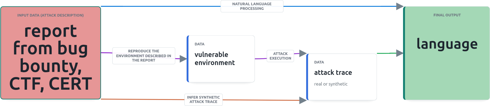

## Context

[MAL (the Meta Attack Language)](https://github.com/mal-lang)  allows to write a language defining components of a system seen during an attack (penetration test), how they are connected to each other.
Given a certain state reached during the execution of the pentest, the language also allows to list what are next the actions available to continue the pentest.
Therefore, having a complete, precise and correct language is helpful to improve pentest on similar environments that are described by this language.

Current research is studying how to use attack traces (list of commands and their output) to generate a language (green arrow on the figure).
However, other sources of data could be investigated to generate a language. 

## project

Appart from attack traces, other public data describe attacks with a varying structuration level.
We can cite bug bounty reports ([list of bug bounty report](https://github.com/djadmin/awesome-bug-bounty)), CTF writeups, incident response report from CERT ([Hugging face incident technical report](https://cdn.openai.com/pdf/67869394-cb91-4c12-888c-5cbd85c7814c/OpenAI-Hugging-Face%20Incident-Technical-Report.pdf))
The project consist in investigating how these public sources can be used to generate a MAL.

Different way can be explored depending on students skills and interests.
- The area of NLP (natural language processing) can be usefull to identify the assets in an un-structured report ([From Text to Insight: Encoding Cyber Attack Patterns in Threat Intelligence Reports Using Knowledge Graphs and LLMs](https://inria.hal.science/hal-05471829v1)) (blue arrow on the figure)
- Generate a synthetic attack trace by recovering the commands that could be launched to reproduce the attack in the report (orange arrow on the figure)
- Reproducing the environment described in the report to actually execute the attack and get a real attack trace (purple arrow on the figure)

<a href="mailto:poisson@kth.se?subject=Degree Project">poisson@kth.se</a>   
